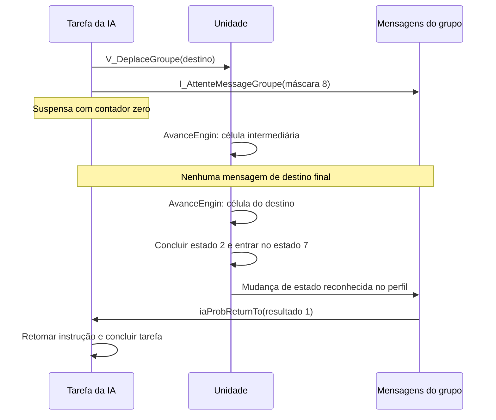

# Avanço físico e mensagens de chegada

A reconstrução agora executa o avanço físico em terreno comum, atualiza ocupação,
visão e minimapa, conclui ordens e entrega mensagens às tarefas que aguardam um
grupo. A implementação está em `avanco_unidades.py`, `visao_movimento.py` e
`mensagens_chegada.py`. Os identificadores franceses das evidências são os
originais recuperados do SBL.

O coordenador básico `MundoFisico` recebe uma **rota já escolhida**.
`MundoNavegacao` agora o estende com escolha direta, desvios locais e busca
geral pelo backend original, conforme [NAVEGACAO.md](NAVEGACAO.md). O despacho
completo de todas as ações por unidade continua pendente. Os
corpos de avanço e mensagem foram comparados com suas funções x86 originais;
o exemplo integrado percorre a mesma sequência delimitada de funções.

## Reproduzir o trajeto completo

```sh
python3 ferramentas/demonstrar_chegada.py
python3 ferramentas/demonstrar_chegada.py --emular
```

A opção `--emular` requer Unicorn e memória JIT, conforme [EMULACAO.md](EMULACAO.md).
O cenário prepara uma unidade do tipo 7, uma rota de `(5,5)` até `(7,5)` e uma
tarefa que ordena o movimento e aguarda a mensagem do grupo.

O relatório [`chegada-emulada.json`](../relatorios/chegada-emulada.json) registra:

- 32 chamadas de avanço, com incremento 2 e desconto zero: 16 por célula.
- Atualização 16: posição passa a `(6,5)`; a tarefa continua suspensa.
- Atualização 32: posição passa a `(7,5)`; ainda está no estado 2.
- Atualização 33: conclusão da ordem, estado 7, mensagem com bit 3 e resultado 1.
- Na atualização seguinte do interpretador, a espera recebe o resultado e a
  tarefa é removida da lista ativa.

A comparação do exemplo usa **104 execuções x86 delimitadas**, adicionais às da
suíte. Confere o estado após cada atualização. Esses ciclos não são uma medida
em segundos nem uma taxa fixa de desenho.



## Avanço entre células

`AvanceEngin` (`0x448704`) conserva a aritmética de oito bits já descrita em
[MOVIMENTO.md](MOVIMENTO.md): incremento menos desconto, soma dos deslocamentos
e progresso com overflow. Um progresso maior que 31 dispara a chegada à célula;
o excesso é descartado e deslocamentos/progresso voltam a zero.

Na chegada, a sequência confirmada é:

1. Retirar a ocupação da célula antiga e registrar a nova.
2. Retirar a marca antiga da unidade no minimapa.
3. Apagar a contribuição de iluminação antiga, salvo donos 4 e 200.
4. Copiar a célula de passo `0x7c` para a posição atual `0x08`.
5. Descobrir e iluminar a nova área, salvo donos 4 e 200.
6. Gravar a marca nova no minimapa.
7. Decrementar a contagem ativa da rota, quando não for zero.
8. Aplicar a parte de fadiga pertinente ao tipo, caso habilitada.

A célula de destino `0x7e` não é substituída por uma célula intermediária.
`EnginEstArrive` (`0x448228`) exige posição igual ao destino e deslocamentos
`0x86/0x87` zerados. A conclusão da ordem é uma etapa posterior do despacho.

### Ocupação e rótulos preservados

`SetEnginCollision` (`0x442cb4`) e `ResetEnginCollision` (`0x442eac`) atualizam
a grade de atributos e os rótulos descritos em [CAMINHOS.md](CAMINHOS.md).
Os tipos 3, 11–16 e 25 usam a pegada de quatro células `c`, `c-1`, `c-257`,
`c-256`; os demais usam uma célula. As subtrações dessas funções são reduzidas
a u16, diferentemente de alguns predicados de consulta.

Os tipos 16 e 17 usam o bit 1 dos atributos e não gravam o identificador na grade
de regiões nesse caminho. Os demais usam o bit 0 e uma palavra de ocupação:

```
0x4000 | (índice_unidade << 3) | subcélula | bit_de_classe
```

O bit de classe vale 4 quando a classe em `0x4962c8` é diferente de 1. Ao inserir,
`Chemin_ModifieZone` (`0x43e138`) só substitui palavras menores que `0x4000`,
guardando o rótulo anterior em `0xfa..0x100`. Ao retirar, só restaura o rótulo
quando o identificador gravado corresponde exatamente à unidade/subcélula.

O método `iniciar_passo` reserva uma célula adjacente já escolhida. Para o exemplo
emulado, a escolha e a reserva são executadas por `EnginNextCaseChemin`
(`0x448b9f`), com suas consultas originais de passagem. A reconstrução recusa um
passo bloqueado que precise de desvio. A extensão `MundoNavegacao` acrescenta a
escolha direta e a invalidação da rota, preservando essa API básica.

## Visão, iluminação e minimapa

Foram reconstruídos os consumidores usados pelo avanço:

| Endereço | Nome original | Efeito |
|---|---|---|
| `0x476e82` | `EteintTerrain` | Retirar a contribuição antiga de iluminação |
| `0x476851` | `DecouvreTerrain` | Descobrir a área nova |
| `0x476cb3` | `IllumineTerrain` | Adicionar a contribuição nova |
| `0x47670a` | `DecouvreCase` | Atualizar descoberta e bordas da célula |
| `0x476968` | `IllumineCase` | Atualizar bordas e contagem de luz |
| `0x476adc` | `EteintCase` | Retirar contribuição e recompor bordas |
| `0x46a388` | `SetMiniMap` | Compor camadas do minimapa |

Cada jogador 0..3 tem três grades de 65.536 bytes: descoberta, bordas de
iluminação e contagem de fontes. Os ponteiros começam em `0x507d78`, `0x507d88`
e `0x507d98`. O teste de descoberta/iluminação verifica se os cinco bits baixos
da grade correspondente estão zerados.

Os quatro bits de borda são atualizados também nas células vizinhas; o bit 4
representa o estado central de descoberta/iluminação nesse código. A contagem
de luz permite sobreposição de fontes: adicionar não passa de 255; retirar de
255 resulta em 254. A recomposição de bordas ao apagar ocorre quando a contagem
anterior era 1.

A área usa distância quadrática inteira, comparada em u16. Para raio maior que
1, o limite é `raio²+1`. `DecouvreTerrain` acrescenta 1 ao raio recebido; no
caminho de avanço, recebe `visão+bonus+2`. Assim, a descoberta usa um raio maior
que a iluminação atual, que recebe apenas `visão+bonus`.

O minimapa mantém camadas de unidades, estruturas e composição final. A posição
é escalada pelas dimensões em `0x496fe0/0x496fe2`, com passo de linha 128 no laço
original. O código conserva essa fórmula, a tabela de sombras, cores por jogador
e a consulta de cor por ID de terreno. Os modos 1..5 usados por essas rotinas
foram traduzidos; os modos 6 e 7 de atualização de estruturas não são chamados
pelo avanço reconstruído.

## Fadiga durante o movimento

O trecho de fadiga é chamado para tipos 0..10 e 25 quando o estado é vivo.
Se `0x72` estiver zerado, não altera nada. Quando habilitado, incrementa `0x74`
em u16 e compara com o limite do tipo mais `0xf8` e o modificador 0 do jogador/tipo.

Abaixo do limite, o contador permanece acumulado. Ao atingir o limite com uma
reserva não zero em `0x04`, a rotina zera o contador e diminui a reserva. O modelo
preserva overflow, bônus e a exceção dos donos 4/200 na consulta do modificador.

O ramo sem provisões exige consumo do inventário, dano, possível morte e som.
Esse ramo é recusado explicitamente antes do avanço, até que esses subsistemas
sejam integrados. Armadilhas hostis de objeto `0x46` também exigem dano/efeitos;
o movimento aéreo dos tipos 16/17 e objetos do próprio dono seguem seus caminhos
sem ativar essa armadilha, como no original.

## Conclusão da ordem e estado ocioso

O ramo do estado 2 em `0x4563da..0x4564ef` compara posição e destino, exige
orientação final e chama `EnginEnArret` (`0x448194`). Essa função escolhe uma pose
final por tipo; alguns tipos conservam seu quadro atual. Depois, o ramo coloca
a unidade viva no estado 7 e libera o contexto de busca quando pertence a ela.

O giro `RotateEngin` (`0x448599`) também foi ligado ao coordenador, incluindo
`0xda = 2*(direção desejada-1)+1` nos tipos 12/15. Sua comparação cobre os 26 tipos,
volta entre orientações 16/1 e o caso já alinhado.

A comparação emulada executa esse ramo até seu retorno ao despacho, sem executar
o restante do ciclo completo por unidade. O coordenador traduzido também usa o
giro já reconstruído e a tolerância de avanço de até duas posições de orientação.
Animação contínua, som de movimento e outras ações do despacho completo continuam
fora desse coordenador.

## Mensagens por mudança de estado

`iagMessTestSendMessageEngin` (`0x483ed7`) não é uma chamada direta de
`AvanceEngin`. Ela compara estado `0x02` e subestado `0x89` com os últimos valores
observados em `0x10a/0x10b`. Se ambos forem iguais, retorna. Quando mudam, atualiza
o cache e só prossegue se:

- O dono estiver em 0..3 e seu tipo de controle em `PlayerGetType` for 2.
- A unidade tiver um grupo válido no dword `0x10c`.
- O grupo tiver uma máscara de espera não zero no dword `+0x1c`.
- O grupo tiver um perfil selecionado no u16 `+0x16` e uma tabela correspondente.

Isso evita mensagens repetidas para o mesmo estado. Registrar uma espera depois
de o estado já ter sido observado não gera automaticamente um evento novo.

### Perfis e resultados

A tabela de ponteiros em `0x498b38` contém os perfis originais, com entradas 0
e 9 nulas. Cada registro de 12 bytes seleciona tipo, estado, subestado opcional,
bit de evento, leitura de payload e possíveis despachos administrativos.

```sh
python3 ferramentas/extrair_perfis_mensagens.py
```

O catálogo com hash está em [`perfis-mensagens.json`](../relatorios/perfis-mensagens.json).
Para cada regra compatível, a rotina acumula `1 << (bit & 31)`. O payload começa
em 1 e pode ser substituído por um campo da unidade, de tamanho 1, 2 ou 4 bytes.
Quando existe ao menos um evento, a máscara de espera do grupo é zerada inteira.
Se os bits encontrados não cruzarem a máscara esperada, o resultado entregue é
`0xffffffff` (-1).

No perfil 1, o tipo 7 no estado 7 gera o bit 3, portanto máscara 8. Esse é o caso
de chegada do exemplo. O mesmo perfil pode transmitir o u16 de `0xc0` no estado
11/subestado 1. Outros tipos ou perfis não necessariamente emitem uma mensagem
de chegada; a reconstrução respeita o catálogo em vez de criar um evento geral.

Os despachos administrativos adicionais de unidade/estrutura presentes em alguns
perfis ainda são recusados com `NotImplementedError`. O caminho de chegada e os
outros casos testados não usam esses despachos adicionais.

### Espera e retomada da tarefa

`I_AttenteMessageGroupe` (`0x481f1a`) registra a tarefa e a máscara no grupo e
chama `iaProbSleep` (`0x47da39`) com contador zero. Ela permanece suspensa até
um evento externo.

A mensagem chama `iaProbReturnTo` (`0x47da54`), que limpa a suspensão, ativa o
flag de resultado pendente, zera o contador e grava o resultado em `0x54`.
A próxima atualização de `iaSolver` copia o resultado para a variável solicitada
pela instrução, escolhe sucesso/falha e continua. A tarefa não é executada
recursivamente dentro do avanço físico.

## Cobertura e limites

Na etapa de avanço e mensagens, a suíte passou com **104 testes e 23.501
execuções x86 delimitadas**. A cobertura atual, incluindo navegação, está no
relatório [validacao-emulada.json](../relatorios/validacao-emulada.json).
As novas comparações verificam registros completos de unidades, estruturas,
grupos e tarefas, grades de colisão/regiões/terreno, descoberta, bordas,
contagens de luz, três camadas do minimapa, rotas e globais de busca/iteração.

Foram cobertos os 26 tipos no avanço/conclusão, donos 0/1/4/200, bordas, cores,
sobreposição de luz, desconto, fadiga com reservas e overflow, payload de mensagem,
cache, controle humano/IA, resultado positivo/negativo e retomada da tarefa.
As chamadas internas são originais e não são interceptadas nesses testes.

Os desvios locais e a busca geral original já foram integrados ao movimento,
incluindo mensagem e retomada da tarefa; veja [NAVEGACAO.md](NAVEGACAO.md).
Continuam pendentes a tradução independente da busca, seleção espacial completa da
tarefa 16, fome sem provisões, armadilhas hostis, despachos administrativos
adicionais, outras ordens/estados e validação numa partida completa.
