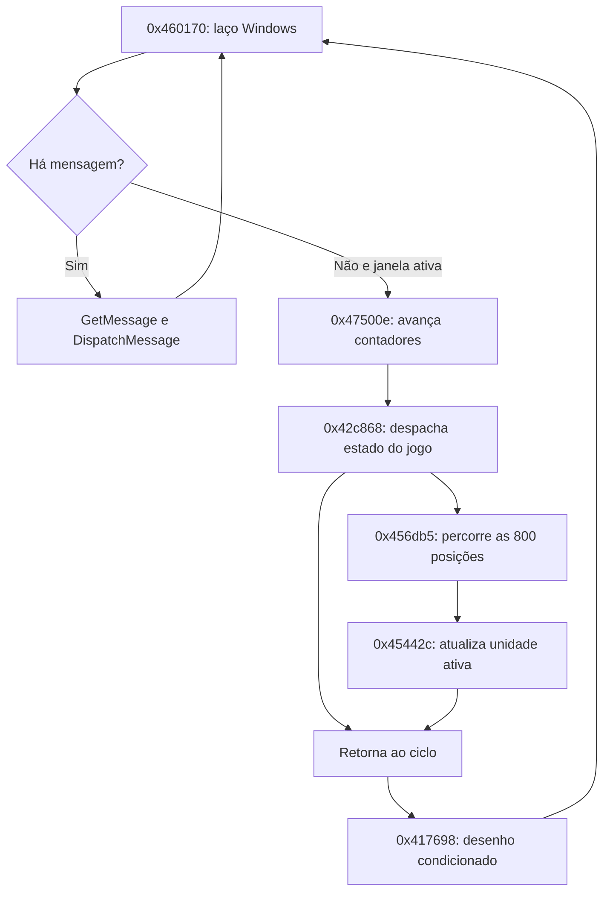

# Ciclo do jogo, desenho e aleatoriedade

O caminho principal examinado **não usa um passo fixo de 1/60 s**. A simulação
é chamada no ciclo ocioso da janela; o desenho pode ser omitido por um divisor.
Isso identifica a ordem de execução, mas não determina a velocidade efetiva
em segundos numa máquina ou camada de compatibilidade específica.

## Cadeia de chamadas



Em `0x4601d1`, `PeekMessageA` verifica a fila. Havendo mensagem, o código a
obtém e despacha; sem mensagem e com a flag de atividade habilitada, chama
`0x47500e` em `0x46020d`. Caso contrário chama `WaitMessage`.

`0x47500e` atualiza três contadores de 32 bits: um por ciclo, outro quando o
primeiro é par e outro quando é divisível por três. Depois consulta o cursor,
chama o despachante do jogo em `0x47505e` e só então o desenho em `0x475063`.
O overflow é preservado: quando o primeiro contador vira zero, os dois
secundários também recebem um incremento naquele ciclo.

No estado de jogo em andamento, `0x42d3f5` chama `0x456db5`. Essa rotina percorre
800 posições, ignora registros de estado zero e chama `0x45442c` para os demais.
A atualização individual distingue ainda estado 4 e outros estados. Conforme
a ordem corrente, ela chega a `0x44930c`, `0x448f50` e à integração do movimento.
Há caminhos de pausa, vídeo e rede no despachante; nem todo ciclo chega ao movimento.

## F1–F4 mudam a frequência do desenho

No tratamento de mensagem `0x100` e estado de jogo `0x12`, os códigos de tecla
`0x70..0x73` escrevem 1..4 no byte `0x497284`. Correspondem a F1–F4 segundo a
[tabela oficial de códigos virtuais](https://learn.microsoft.com/en-us/windows/win32/inputdev/virtual-key-codes).
O valor inicial no executável é 1.

Em `0x417909`, uma flag pode forçar desenho. Caso contrário, só desenha quando
`contador_ciclo % divisor == 0`. Com divisor 4, três ciclos podem atualizar a
simulação sem desenhar a cena. Portanto, não se deve identificar incremento de
simulação com cada quadro apresentado ao usuário. O efeito exato sobre o tempo
real depende do custo de cada ciclo e das chamadas de sistema/gráficas.

`avancar_contadores` e `deve_desenhar`, em
[`cadencia.py`](../ferramentas/cadencia.py), reproduzem esses trechos. A bancada
conferiu também o próprio tratamento das quatro teclas no código original.

## A consulta a GetTickCount não é o limitador

`0x43f710`, chamado antes do filtro de desenho, incrementa um contador, consulta
`GetTickCount` e, após pelo menos 1.000 ms, monta dois dígitos limitados a 99.
Não há espera nesse trecho. Ele mede frequência de chamadas, não estabelece
uma taxa de 60 atualizações por segundo. Há ainda chamadas a `timeGetTime`
relacionadas a vídeo, áudio, rede e semeadura aleatória; sua presença isolada
não comprova um relógio fixo para o movimento.

O caminho de apresentação em `0x43f14f` faz chamadas indiretas da superfície
gráfica e repete algumas delas para certos códigos de erro. O comportamento
temporal dessas APIs e de possíveis wrappers precisa ser medido num ambiente
de execução do jogo. A pesquisa não afirma que não exista qualquer outro
mecanismo de sincronização no programa inteiro.

## Gerador aleatório encontrado durante o rastreamento

`0x489728` usa estado global em `0x498db4`. No caminho de argumento positivo:

```text
q, r = divisão_do_estado_por_127773
novo = r * 16807 - q * 2836
se novo <= 0: novo += 2147483647
resultado = novo % argumento
```

`proximo_aleatorio` reconstrói esse caminho. Para estado 1, os dois primeiros
estados são 16807 e 282475249. Estado zero leva a 2147483647, que permanece
degenerado nas chamadas seguintes; o teste conserva esse caso de borda.
Argumento zero chama `timeGetTime` para semear; argumento negativo usa outra
regra de semeadura. Esses dois caminhos não estão implementados na primitiva.

## Evidências e reprodução do rastreamento

Os trechos com bytes estão em `evidencias/`: `laco_principal_windows.asm`,
`ciclo_atualizacao_desenho.asm`, `despacho_simulacao.asm`, `iterar_unidades.asm`,
`mensagens_teclas_cadencia.asm`, `filtro_cadencia_desenho.asm`,
`contador_frequencia.asm`, `apresentar_superficie.asm` e `gerador_aleatorio.asm`.

Os grafos de referências estão em `evidencias/rastreamentos/*.tsv`. `sem_funcao`
significa que o Ghidra não associou a instrução a uma função; não significa
ausência de código. Isso ocorreu com o laço Windows e o tratamento de mensagens,
cujos bytes foram então examinados diretamente.

Para repetir uma investigação, mantendo os dumps extensos em área local ignorada:

```sh
python3 ghidra/executar.py headless ghidra/projetos RisingLands \
  -process RISING-analise.exe -noanalysis -scriptPath ghidra/scripts \
  -postScript RastrearChamadores.java .local/rastreamentos/relogio 3 \
  0x5231b8 0x5234a4 0x44930c
```

As outras duas consultas registradas usam profundidade 2 para `0x42c868`,
`0x5099b0`, `0x5232b8`, e profundidade 1 para `0x497284`, `0x508f7c`.
