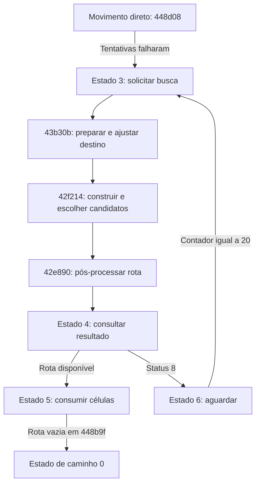

# Busca de caminhos, ocupação e regiões

Implementação parcial em [`caminhos.py`](../ferramentas/caminhos.py); experimentos
com as rotinas originais em [`bancada_caminhos.py`](../ferramentas/bancada_caminhos.py).
A pesquisa usa o mesmo RISING.EXE identificado em [EMULACAO.md](EMULACAO.md).
O backend de [CONTORNOS.md](CONTORNOS.md) já executa o núcleo das três classes
de ocupação sem EXE ou Unicorn, com limites para estruturas e desbloqueio de aliados.
Não há evidência suficiente
para classificar o original como A*. O SBL revelou os nomes originais
`CheminCalcul`, `Chemin_Verouille`, `OptimiseChemin` e `EnginNextCaseChemin`;
veja [SIMBOLOS.md](SIMBOLOS.md).

A integração atual está em [NAVEGACAO.md](NAVEGACAO.md): desvios locais,
geração de regiões, invalidação de rota e controle dos estados em Python,
com a busca geral original fornecida por um backend explícito. O movimento
já percorre uma passagem ao redor de uma parede e entrega a mensagem à tarefa.
O teste de linha e a otimização posterior agora estão traduzidos e podem ser
usados pelo backend misto de [OTIMIZACAO_CAMINHOS.md](OTIMIZACAO_CAMINHOS.md).
Preparação/ajuste e início/seleção dos candidatos estão descritos em
[PREPARACAO_CANDIDATOS.md](PREPARACAO_CANDIDATOS.md). A construção dos dois
contornos foi depois traduzida nas classes 1..3, conforme [CONTORNOS.md](CONTORNOS.md).

## Fluxo confirmado



`0x44930c` despacha a busca. No estado 3, só inicia o trabalho quando os
deslocamentos `0x86/0x87` estão zerados e `0x4e0f36` está livre. Esse flag,
o índice `0x496304` e o ponteiro `0x4e0f3c` mostram um contexto de busca global
compartilhado. O estado 4 pode chamar novamente `0x42f214` se ainda não terminou.
No estado 6, `0x8b` aumenta em oito bits; **igualdade** com 20 zera o contador
e muda para estado 3. Não é uma espera de 20 milissegundos.

A preparação `0x43b30b` recebe início em AX, destino em DX, unidade em BX,
máscara em CL e três argumentos na pilha: buffer de saída e dois flags. O
chamador fornece flags zero e máscara `1 + (unidade[0xab] != 0)`.

## A grade mistura rótulos e ocupantes

`0x42d4f8` primeiro verifica os limites x/y com largura e altura em
`0x497168/0x49716a`. Depois compara dois rótulos recuperados da grade u16
apontada por `0x4e0f38`, indexada por `x + 256*y`:

| Palavra da grade | Resolução |
|---|---|
| Bit `0x8000` presente | Estrutura `(valor & 0x7fe0) >> 5`; subcélula `valor & 31` |
| Sem `0x8000`, com `0x4000` | Unidade `(valor & 0x3ff8) >> 3`; subcélula `valor & 3` |
| Nenhum desses bits | O valor já é o rótulo |

A palavra sob a estrutura fica em `0x49a194 + índice*276 + subcélula*2`.
Sob a unidade fica em `ponteiro_unidades + índice*276 + 0xfa + subcélula*2`.
Isso explica os quatro u16 em `0xfa..0x100` das unidades. O bit 2 da palavra
codificada da unidade **não** participa da subcélula. A resolução acontece
uma vez, sem interpretar novamente os bits do valor recuperado.

A expressão “mesma região” descreve essa comparação de rótulos. A geração de
componentes naturais foi reconstruída em `regioes_mapa.py`; construções e suas
grades auxiliares ainda exigem trabalho. Igualdade não garante uma
rota livre diante de obstáculos e ocupantes dinâmicos. Na preparação, rótulos
diferentes encerram a solicitação com status 7.

## Máscaras e ocupação própria

`0x43ec0c` testa a célula: se `objetos[célula] == 0xfd`, retorna se o bit 0
da máscara está ativo; nos outros casos, retorna `atributos[célula] & máscara != 0`.
Os ponteiros são `0x507d74` e `0x507da8`. Nas rotinas de caminho, um resultado
positivo conduz às verificações adicionais de ocupação. Não se deve chamar
um resultado positivo de “terreno livre”. O significado de todos os demais
bits do terreno permanece aberto.

`0x43eb64` reconhece células da própria unidade, salvo três exceções:
`campo_ab == 50 && máscara == 1`, `campo_ab == 0 && máscara == 2`, ou estado 14.
Classe 1 compara somente a célula atual; as demais classes reconhecem também
`atual-1`, `atual-257` e `atual-256`. As subtrações são de 32 bits: não devem
ser reduzidas a u16 para criar uma ocupação que atravessa a borda.
A tabela de classes dos 26 tipos, em `0x4962c8`, foi preservada no módulo Python.

## Passagem por outra unidade

`0x42eba4` e `0x42ece0` consultam a unidade que ocupa a célula e usam:

- Aliança direcional em `0x46d838`: igualdade de donos sempre retorna verdadeiro;
  para donos distintos de 0 a 4, consulta o bit do destino no byte `+6` do
  registro de 20 bytes do dono de origem. Não força reciprocidade.
- Direção desejada do ocupante (`0x90`) versus direção consultada, dividida
  por dois com truncamento em direção a zero e normalizada no círculo de oito
  posições. Diferenças -1, 0 e 1 são aceitas.
- Ocupante “movendo” quando célula atual difere do destino, com exceções para
  tipos 0, 1, 20 e 21 no estado 1/campo `0x8a=1`, e tipos 6 e 7 no estado
  15/campo `0x89=1`.
- Flag global `0x4e1771`, que permite o caso de aliado parado.
- Exceção entre adversários: tipo solicitante 12 ou 15 e ocupante de tipo
  0, 1, 2, 4–10, 18, 19 ou 22. Os efeitos de atropelamento associados ao movimento
  ainda não foram traduzidos; a consulta de passagem sozinha não os executa.

A variante `0x42eba4` retorna 1 para a exceção entre tipos, 2 para a permissão
por direção/flag e 0 para recusa. `0x42ece0` retorna 1 nos dois casos positivos.
Essas funções são critérios locais: retornar verdadeiro não executa movimento,
combate ou remoção de ocupante.

## Dois candidatos, sorteio e ordem das células

`0x42f214` escreve dois buffers em `0x4e116a` e `0x4e136a`, cada um com contador
u16 e células u16. A seleção em `0x43b25c` compara dois valores u16 da pilha;
num empate, chama `0x4704dc` e escolhe o primeiro buffer quando os dois bits
baixos do resultado são zero; nos outros três valores escolhe o segundo.
O gerador usa a mesma recorrência do gerador de [CADENCIA.md](CADENCIA.md), mas
com **estado separado em `0x497164`**, e retorna o estado inteiro.

Depois da seleção, `0x42e890` pós-processa o buffer e consulta `0x42d674`.
A serialização `0x43b2be..0x43b300` inverte a sequência. O consumidor
`0x448b9f` lê `buffer[contador]`: a próxima célula fica no final ativo do buffer.
A contagem só diminui em `0x448aaa..0x448ac6`, no trecho de chegada de
`0x448704`, depois dos efeitos de ocupação e visão. `consumir_passo_concluido`
reproduz esse decremento; não executa os efeitos anteriores. O buffer conserva
as células antigas fora da contagem ativa. Quando a contagem fica zero,
`0x448b9f` coloca o estado de caminho em zero e o fluxo de movimento pode
voltar à tentativa direta. Foram comparadas 256 contagens na bancada.

Uma contagem de 255 possui tratamento específico (status 3) e não deve ser
interpretada automaticamente como uma rota completa.

Há comparações `CMP AL,AL` em `0x43b11b` e `0x43b1e9`. Elas devem ser mantidas
como evidência, sem “corrigir” o original com base no pseudocódigo.

## Experimentos reproduzíveis

```sh
python3 ferramentas/bancada_caminhos.py
```

Requer Unicorn e memória JIT conforme [EMULACAO.md](EMULACAO.md). O comando
registra nove cenários em [`caminhos-experimentos.json`](../relatorios/caminhos-experimentos.json).
Carrega o EXE original e executa preparação, busca e pós-processamento, sem
substituir suas chamadas. Cada chamada tem limite de 20.000 instruções e um
segundo. As grades são sintéticas; não se inicializa uma partida inteira.

Com origem `(2,2)` e destino `(8,2)`, no cenário aberto foram emitidas apenas
`(3,3), (4,2)`. Uma parede em x=3, y=0..5 mudou a saída para `(2,3)`.
Um destino bloqueado foi ajustado para `(7,1)`, com status 2. Dois rótulos
diferentes foram rejeitados com status 7 e nenhuma célula. Início igual ao
destino retornou sucesso com buffer vazio.

Os experimentos antigos mantêm rótulos sintéticos simplificados, sem reconstruir
os componentes naturais. As novas demonstrações de [NAVEGACAO.md](NAVEGACAO.md)
geram os rótulos e acompanham o trajeto físico, produzindo uma rota ao redor
da parede até a passagem. Os relatórios são preservados separadamente para
explicitar a diferença de inicialização.

Esses resultados demonstram por que o flag de sucesso não equivale a “chegou
ao destino”. São observações do contexto sintético, não uma garantia de como
uma partida completa resolve cada obstáculo. Os testes conferem reprodução,
limites do mapa, adjacência e ausência das células bloqueadas nessas saídas.

## Limites e continuação

A implementação Python cobre as primitivas descritas, componentes naturais,
movimento direto, consumo, nova busca, `TestLigneOptimise` e `OptimiseChemin`,
assim como preparação/ajuste, início/seleção e construção dos dois contornos
nas classes 1..3. O backend original permite conferir essa implementação
independente. Os próximos passos são preparar construções e suas grades
auxiliares, traduzir o desbloqueio de aliados, ampliar tráfego e inicializar mapas reais.

Evidências novas: `evidencias/caminhos-ia/`, `caminhos-auxiliares/` e
`caminhos-runtime/`; funções maiores já estavam em `evidencias/ghidra/`.
