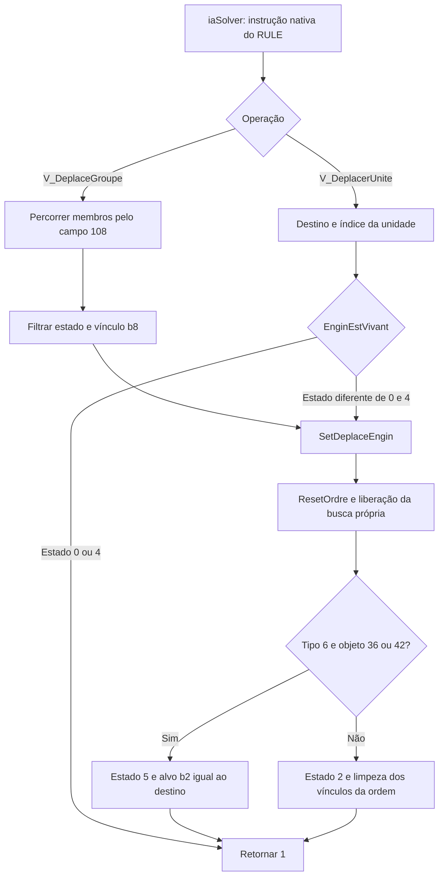

# Efeitos das tarefas de movimento sobre as unidades

A máquina de tarefas agora recebe um `MundoUnidades` opcional e executa
`V_DeplacerUnite` e `V_DeplaceGroupe` sobre seus registros. A implementação está
em [`ordens_unidades.py`](../ferramentas/ordens_unidades.py); a ligação ao
interpretador está em [`tarefas_ia.py`](../ferramentas/tarefas_ia.py).

Foram reconstruídos os efeitos da **emissão de ordens**, incluindo todas as
chamadas feitas pelas duas operações no domínio estudado. A posição física é
atualizada posteriormente por `DeplaceEngin` e pelas rotinas de passo. A emissão
preserva a posição atual, a célula de passo e o progresso do deslocamento.

## Fluxo confirmado



As funções são da edição identificada pelo hash em
[EMULACAO.md](EMULACAO.md). Os nomes franceses são originais do SBL.

| Endereço | Nome original | Efeito |
|---|---|---|
| `0x481146` | `V_DeplacerUnite` | Solicitar movimento de uma unidade elegível |
| `0x481f4c` | `V_DeplaceGroupe` | Solicitar movimento dos membros elegíveis |
| `0x443dad` | `EnginEstVivant` | Aceitar estados diferentes de 0 e 4 |
| `0x4457d3` | `SetDeplaceEngin` | Gravar a nova ordem e seus vínculos |
| `0x44357c` | `ResetOrdre` | Redefinir os campos da ordem anterior |
| `0x47610f` | `TerrainEstCaisse` | Reconhecer os códigos de objeto `0x36` e `0x42` |
| `0x4837f0`, `0x483825` | `iagUnitGetFirstUnitInGroup`, `iagUnitGetNextUnitInGroup` | Percorrer o encadeamento do grupo |

## Ordem individual

`V_DeplacerUnite` recebe **destino como primeiro argumento e índice da unidade
como segundo**. Ambos são reduzidos a u16. Se o estado for 0 ou 4, não altera
a unidade. O retorno continua sendo 1, portanto sucesso da instrução não prova
que uma ordem foi emitida nem que a unidade chegou.

A operação não consulta o dono da unidade, a aliança, os limites do mapa ou a
existência de um caminho. Essas condições podem ser tratadas por quem escolhe
a ordem e pelas etapas posteriores do movimento. O teste integrado inclui uma
tarefa do jogador 0 emitindo ordem para uma unidade cujo dono é 3, conforme
permite esse trecho original.

### Redefinição da ordem anterior

`ResetOrdre` realiza estes efeitos:

- Se os deslocamentos `0x86` e `0x87` forem zero e o tipo for diferente de 16,
  zera o quadro `0xa4` e o contador de animação `0xa9`.
- Para o tipo 13, se `0xc0` apontar para uma estrutura, chama `BatimentDelocke`
  (`0x4237ff`) e zera o byte `+0x74` dessa estrutura. Se seu byte `+0x76` for
  15 e `+0x75` for diferente de zero, também zera `+0x75`, por
  `TuyauEstSortie` (`0x420c7c`) e `BatimentTuyauCave` (`0x41a65c`).
- Copia a célula de passo `0x7c` para o destino `0x7e`, limpa `0x88` e `0x82`,
  coloca `0xb2=0xffff` e define estado 2.
- Libera o contexto de busca se ele pertencer à unidade.

Os dois bytes da estrutura são os efeitos observados. Isso não representa,
por si só, destruição da estrutura ou uma implementação completa do cancelamento
de construção. Os registros de estruturas usam base `0x49a0c8` e passo 276.

### Busca de caminho compartilhada

Quando `0x496304` contém o índice da unidade que recebe a ordem, os seguintes
campos são modificados:

| Global | Novo valor |
|---|---:|
| `0x4e0f36` — contexto ocupado | 0 |
| `0x4e0f37` — sucesso | 0 |
| `0x4e0f3c` — ponteiro da rota | 0 |
| `0x496304` — unidade da busca | `0xffff` |

O byte de conclusão `0x496302` é preservado. Se a busca pertencer a outra unidade,
todos esses campos permanecem intactos. O buffer da rota anterior não é apagado
por essas funções; o estado da unidade deixa de usá-lo nesse caminho.

### Nova ordem e exceção do tipo 6

No caminho comum, `SetDeplaceEngin` grava:

| Campo da unidade | Valor |
|---|---|
| `0x7e` | Destino u16 |
| `0x88` | 0 |
| `0x02` | 2 |
| `0xb8`, `0xb2`, `0xc0` | `0xffff` |
| `0xbe` | `0xff` |

O campo `0x89` conserva o valor anterior. A posição atual `0x08`, a célula de
passo `0x7c`, deslocamentos `0x86/0x87` e progresso `0x97` não são reiniciados.
Isso permite terminar o passo já em andamento antes de seguir a nova ordem.

Para o tipo 6, quando `objetos[destino]` é `0x36` ou `0x42`, a rotina chama
`ResetOrdre` novamente, usa **estado 5**, escreve `0x89=1`, grava o destino em
`0x7e` e `0xb2`, e zera `0x88`. Nesse ramo, `0xb8`, `0xbe` e `0xc0` não recebem
a limpeza do caminho comum. A grade de objetos, apontada por `0x507d74`, é
apenas consultada durante a emissão.

## Ordem de grupo

`V_DeplaceGroupe` recebe **grupo primeiro e destino depois**. O primeiro membro
é o u16 no offset `+0x10` do registro de grupo, na base `0x51a9e0` com passo 32.
O próximo membro está no u16 `+0x108` da unidade; `0xffff` encerra a lista.

A operação só emite a ordem quando o membro:

1. Tem estado diferente de 0 e 4; e
2. Não está no estado 1 com `0xb8` diferente de `0xffff`.

Essa segunda restrição é específica da operação de grupo. A operação individual
não a aplica. A ordem do encadeamento é preservada, assim como os vínculos
`+0x108`. O percurso também atualiza os globais `0x51b844` (ponteiro do grupo)
e `0x51b848` (membro atual, `0xffff` no fim).

O modelo usa o domínio de 100 grupos, 800 unidades e 1.000 estruturas. Índices
fora dessas tabelas e ciclos no encadeamento são recusados explicitamente.
Essas verificações de integridade são próprias da reconstrução; o código
original não apresenta as mesmas validações de limites nesses acessos.

## Consultas disponíveis para as tarefas

`I_DonneTypeUnite` (`0x481133`) devolve o byte de tipo, por meio do acessor
`0x442025`. `B_TestUniteFaitRien` (`0x481110`) consulta o estado por `0x440e11`
e retorna 1 se ele for 7; nos outros casos retorna -1. Nenhuma das consultas
exige que `EnginEstVivant` aceite a unidade.

As quatro operações são atendidas diretamente pela máquina quando `mundo` é
fornecido. Sem esse estado, ela recusa a operação com `NotImplementedError`,
para que uma tarefa não conclua silenciosamente sem seu efeito.

## Reproduzir uma tarefa com efeitos

```sh
python3 ferramentas/demonstrar_movimento_ia.py
```

A demonstração usa cinco estados sintéticos: movimento comum, unidade no estado
4, tipo 6 diante de caixa, construtor com referência anterior e grupo misto.
Gera [`movimento-ia-local.json`](../relatorios/movimento-ia-local.json), contendo
argumentos, registros antes/depois, contexto de busca e campos da estrutura.

Para confrontar os mesmos cenários com todas as chamadas originais:

```sh
python3 ferramentas/demonstrar_movimento_ia.py --emular
```

Requer Unicorn e memória JIT, conforme [EMULACAO.md](EMULACAO.md). O relatório
[`movimento-ia-emulado.json`](../relatorios/movimento-ia-emulado.json) registra
15 execuções delimitadas, adicionais às da suíte de testes. As tarefas da
demonstração são programas mínimos sintéticos que chamam as operações reais.

## Validação e limites

Foram acrescentados cinco testes comuns e dez diferenciais. Os diferenciais
executam os wrappers, `SetDeplaceEngin`, `ResetOrdre`, auxiliares de estrutura,
consultas e percurso de grupo **sem substituir chamadas**. A comparação cobre
os 220.800 bytes das unidades, 276.000 das estruturas, 3.200 dos grupos, 65.536
da grade de objetos e os globais de busca e iteração. Na integração, também
confere os 9.600 bytes das tarefas, listas e total ativo.

Os cenários cobrem os 26 tipos, os 256 valores do byte de estado, caixas,
unidades paradas/em deslocamento, animação do tipo 16, construtores com referências
nas bordas da tabela, buscas próprias e alheias, grupos vazios/mistos, truncamento
u16 e dados determinísticos aleatórios. Uma tarefa sintética consulta, move,
espera e conclui usando os corpos originais das operações.

A instrução **427 do RISING.RUL original** também foi executada com suas variáveis
preenchidas e o contador da tarefa posicionado nela. O prefixo espacial 422..426
não foi executado nesse experimento. A tarefa 16 completa ainda requer as consultas
de construções/cidade e a seleção de célula livre descritas em [TAREFAS.md](TAREFAS.md).

A suíte inteira passou com **92 testes e 22.851 execuções x86 delimitadas**.
A próxima integração é avançar a simulação da unidade após a emissão, incluindo
colisão, ocupação, visão e mensagens de conclusão. Os nomes de campos ainda
sem significado confirmado permanecem como offsets.
