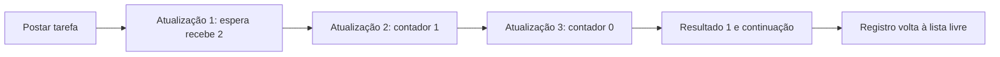
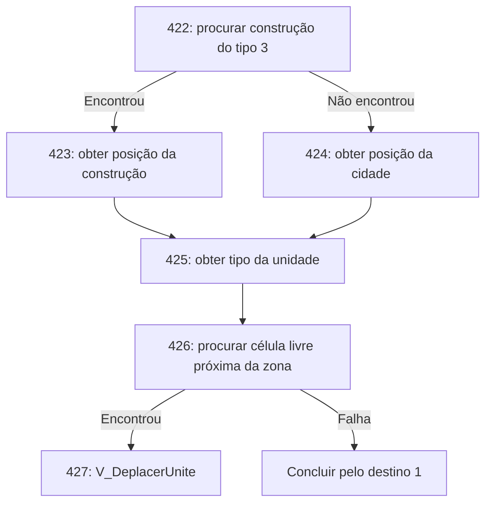

# Máquina de tarefas da IA

A reconstrução em [`tarefas_ia.py`](../ferramentas/tarefas_ia.py) executa o
controle de fluxo de `iaSolver`, com criação, subtarefas, suspensão, retomada
e liberação. A espera `V_Attendre` tem seu ciclo completo implementado e
comparado com o x86 original. As operações de mundo ainda não traduzidas
lançam `NotImplementedError`; não recebem sucesso fictício. As ordens individuais
e de grupo já produzem efeitos no `MundoUnidades`, conforme [ORDENS_MOVIMENTO.md](ORDENS_MOVIMENTO.md).

As regras são carregadas por `simbolos_ia.ler_rul`. Os identificadores franceses
são os originais recuperados do [SBL e RULE](SIMBOLOS.md).

## Memória e listas

`0x47d220` inicializa um reservatório de **100 registros de 96 bytes** na base
`0x512320` e cinco listas de jogadores, com contextos de 16 bytes em `0x5148b0`.
A lista de registros livres fica em `0x5148a0`. Seu contexto contém cabeça,
campo de contagem, passo do registro e ponteiro da base.

O inicializador `0x47cfd0` deixa o campo de contagem em **100 inclusive nas
listas vazias de jogadores**. A reconstrução preserva esse comportamento;
não usa esse campo como número real de tarefas ativas. O total ativo separado
fica em `0x514904`.

| Offset da tarefa | Campo recuperado |
|---:|---|
| `0x00` | Próxima tarefa da lista; -1 encerra |
| `0x04` | Tarefa pai; -1 quando não há |
| `0x08` | Inicializado em -1; significado ainda parcial |
| `0x0c` | Índice da instrução atual |
| `0x10` | Inicializado em zero; significado ainda parcial |
| `0x14` | Contador de espera |
| `0x18..0x50` | Quinze variáveis u32 |
| `0x54` | Resultado pendente, usado na retomada |
| `0x58` | Tipo da subtarefa pendente, u16 |
| `0x5a` | Tipo da própria tarefa, u16 |
| `0x5c` | Jogador |
| `0x5d` | Inicializado em 255; significado ainda parcial |
| `0x5e` | Suspensa |
| `0x5f` | Resultado disponível para retomada |

`iaProbNew` retira o primeiro registro livre. `iaProbPost` grava seis argumentos
e adiciona a tarefa ao fim da lista do jogador. A alocação não zera todo o
registro: variáveis e outros campos podem conservar bytes da utilização anterior.
Os testes comparam os **9.600 bytes da tabela**, inclusive após reutilização.

## Argumentos e decisões

No campo u32 de formato da instrução:

- Bits 0..3: variável que recebe o resultado; zero descarta.
- Bits 4..7: quantidade de argumentos.
- A partir do bit 8: um nibble por argumento. Zero escolhe a constante da
  instrução; valores de 1 a 15 escolhem a variável correspondente da tarefa.

O corpus usa no máximo cinco argumentos por instrução. Os argumentos de uma
operação nativa são preparados numa área temporária que também recebe jogador
e índice da tarefa. A interpretação não depende de protótipos C automáticos.

**Somente `0xffffffff` (-1) escolhe o desvio de falha.** Zero e todos os outros
valores seguem o desvio de sucesso. Por isso, funções de comparação retornam
1 ou -1, em vez de usar a convenção booleana Python de 1 ou 0.

Destinos 0 e 3 removem a tarefa; destinos 1 e 2 também escrevem 1 ou -1 no pai,
quando existe. Outros destinos passam imediatamente à próxima instrução. Um
limite explícito na reconstrução interrompe ciclos intermináveis sem fingir
que a tarefa concluiu.

## Espera completa

`V_Attendre` (`0x47da7a`) marca a tarefa como suspensa e copia o argumento para
`0x14`. Nas atualizações seguintes, `iaSolver` trata o contador como inteiro
com sinal. Se for positivo, decrementa; quando chega a zero, marca resultado
pendente 1 e continua pela instrução que estava aguardando.

Exemplo com espera de duas atualizações:

Zero ou um valor negativo mantém a suspensão indefinidamente nesse mecanismo;
seria necessária uma intervenção externa para retomá-la. A espera é medida em
chamadas do interpretador, não em segundos nem quadros desenhados.

## Subtarefas

Uma operação numérica cria a subtarefa pelo tipo e copia os argumentos. O filho
é inserido logo depois do pai na lista; o pai fica suspenso. O percurso atual
usa o próximo índice salvo antes da inserção, portanto o filho recém-criado
começa numa atualização posterior.

Quando o filho termina, remove-se seu registro da lista e devolve-se ao
reservatório livre; o pai recebe os flags de retomada. Os destinos 1 e 2 do
filho também definem o resultado pendente do pai. Os destinos 0 e 3 preservam
esse resultado anterior. Na retomada de uma subtarefa, o campo `0x58` é zerado
e o resultado não é copiado automaticamente para a variável de destino da
instrução; ele ainda seleciona seu desvio de sucesso/falha.

O campo de contagem da lista do jogador não é incrementado na inserção interna
do filho, embora seja decrementado na remoção. Esse detalhe também foi
preservado; o modelo não “corrige” a contabilidade observada.

## Operações independentes do mundo

| Operação original | Comportamento reconstruído |
|---|---|
| `B_Egalite` | Igualdade dos dois valores; retorna 1 ou -1 |
| `B_Superieur` | Comparação com sinal de 32 bits |
| `I_Addition` | Soma com overflow de 32 bits |
| `I_Soustraction` | Retorna zero se A < B com sinal; senão subtrai em 32 bits |
| `I_PourcentageAB` | Divide com sinal, trunca e **depois** multiplica por 100 |
| `I_Affecte` | Retorna o primeiro argumento |
| `I_NumMission` | Lê o número da missão em oito bits |
| `I_Divise` | Divisão com sinal; divisor zero retorna -1 |
| `V_Attendre` | Suspende e configura contador de espera |

`I_PourcentageAB(50,100)` retorna zero; não retorna 50. `I_PourcentageAB` não
possui o tratamento de divisor zero de `I_Divise`. Divisão impossível no x86
é sinalizada no modelo como erro aritmético.

Os aliases que retornam constantes em `0x47f31c` e `0x47f322` também foram
preservados, conforme [SIMBOLOS.md](SIMBOLOS.md). As operações restantes podem
ser fornecidas explicitamente por callbacks durante pesquisa; os testes desta
máquina **não** usam callbacks para substituir as operações comparadas.

## Regra real ligada ao movimento

O tipo de tarefa 16 entra na instrução 422 de `RISING.RUL`. Seu fluxo contém:

Esse fluxo foi extraído das instruções e nomes originais. `I_DonneTypeUnite`
e os efeitos de `V_DeplacerUnite` já foram reconstruídos. A instrução 427 foi
comparada com o x86, iniciando a tarefa diretamente nela com as variáveis
preenchidas; o prefixo espacial 422..426 continua pendente. O tipo 14, cuja
entrada 420 chama `B_Bidon`, foi executado integralmente usando o programa real.
Detalhes e demonstrações em [ORDENS_MOVIMENTO.md](ORDENS_MOVIMENTO.md).

## Validação

`test_emulacao_tarefas.py` compara o modelo com
[`bancada_tarefas.py`](../ferramentas/bancada_tarefas.py). Essa bancada executa
`iaProbPost`, `iaProbNew`, as operações de listas, `iaSolver` e as operações
nativas suportadas com os bytes originais, sem substituir chamadas. Confere
retorno, tabela inteira de tarefas, listas livres/por jogador e total ativo.

Os cenários cobrem espera positiva/zero/negativa, seis operações aritméticas,
limites de sinal, todos os jogadores, reservatório cheio, tipos inválidos,
subtarefas com três tipos de conclusão, aliases constantes, missão em oito bits,
reutilização e uma regra do arquivo real. A resolução dos 140 nomes também foi
conferida contra o runtime original.

Os primeiros efeitos de mundo implementados são as ordens de movimento individuais
e de grupo. Ainda faltam o avanço físico integrado, as mensagens assíncronas de
grupos/construções, tarefas de economia/guerra completas e a validação em partida.
